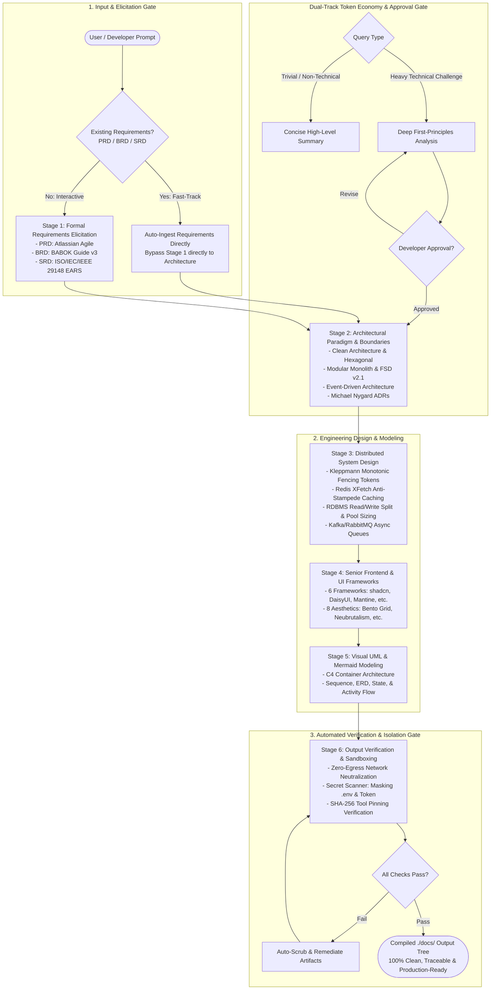

# architect-skill

> Enterprise-grade, local-first, zero-egress software architecture generator and specification framework for AI agents.

[](SECURITY.md)
[](LICENSE)
[](docs/workflow.md)
[](CONTRIBUTING.md)
[](https://nodejs.org)
[](adapters/README.md)

---

<p align="center">
  <a href="docs/workflow.md"><b>📖 Dokumentasi Alur (Workflow)</b></a> •
  <a href="docs/quickstart.md"><b>🚀 Quickstart Guide</b></a> •
  <a href="docs/wizard-guide.md"><b>🧙 Wizard Guide</b></a> •
  <a href="adapters/README.md"><b>🤖 Multi-Agent Adapters</b></a> •
  <a href="CONTRIBUTING.md"><b>🤝 Contributing</b></a> •
  <a href="SECURITY.md"><b>🛡️ Security Policy</b></a> •
  <a href="LICENSE"><b>📄 MIT License</b></a>
</p>

---

## 1. Overview & Core Philosophies

`architect-skill` is an authoritative software architecture toolkit designed to operate across seven major AI coding environments: Claude Code & Desktop, Cursor IDE, Continue.dev, Codeium Windsurf, Cline Autonomous Agent, OpenAI Codex CLI, and Google Antigravity.

Unlike typical AI prompts that produce superficial code suggestions or make ungrounded assumptions, `architect-skill` operates as a deterministic architectural inference engine. It synthesizes enterprise-grade specifications, data schemas, distributed system safeguards, and visual UI tokens into an organized `./docs/` hierarchy within your project.

### Foundational Principles:
1. **Primacy of Logic over Heuristics**: All architectural paradigms, system design trade-offs, and requirement clauses are rooted in formal standards (ISO/IEC/IEEE 29148:2018, BABOK Guide v3, Atlassian Agile PRD, Robert C. Martin, Martin Fowler, Martin Kleppmann).
2. **Existing Requirements Fast-Track**: If a user brings an existing PRD, BRD, or SRD (or any subset), the system auto-ingests the documents directly and bypasses Stage 1 to proceed to Stage 2 architecture modeling without redundant elicitation questions.
3. **Dual-Track Context & Token Economy**: Trivial, high-level, and non-technical questions are answered concisely with immediate conclusions to save tokens and context window. Heavy technical challenges undergo deep first-principles analysis until resolved, followed by an explicit developer approval gate before files or systems are modified.
4. **Absolute Zero-Egress & Local-First**: 100% offline execution. No outbound network requests, no remote telemetry, no external API dependence. All memories, vibe-coding artifacts, and state are strictly persisted locally, eliminating cloud training risks.
5. **Absolute Credential Protection**: The skill is structurally prohibited from reading `.env` files, system credentials, SSH/AWS keys, certificates, private keys, or agent authentication tokens. Built-in secret scanning and automatic masking neutralize stray credentials before write operations.
6. **Constructive Minimalism**: Pure Node.js implementation without external npm dependencies (`zero-dependency`), eliminating software supply chain risks.

### End-to-End Architectural Workflow Diagram



---

## 2. Two-Tier Execution Framework

`architect-skill` provides two calibrated operational tiers:

| Attribute | Tier 1: Rapid / Lightweight Architecture | Tier 2: Enterprise / Comprehensive Architecture |
|---|---|---|
| **Target Scope** | MVPs, early prototypes, standalone microservices, internal CLI utilities | Mission-critical systems, distributed clusters, regulated enterprise platforms |
| **Interaction Time** | 3 to 5 rapid steps (< 5 minutes) | 6 deep validation stages (15 to 30 minutes) |
| **Requirements Scope** | Consolidated `PRD.md` with problem framing and acceptance criteria | Complete `BRD.md` (BABOK RACI/ROI), `PRD.md` (Atlassian), and `SRD.md` (ISO 29148 EARS clauses) |
| **Architecture Scope** | `layer-rules.md`, `directory-tree.md`, 1x core ADR | Layer rules, directory tree, `dependency-injection.md`, 3+ comprehensive ADRs |
| **System Design** | Primary database schema selection and baseline caching | Redis caching lifecycle, distributed locking with fencing tokens, RDBMS scaling, message queues |
| **Diagrams (Mermaid + text twin)** | 2 diagrams: C4 Container and Relational ERD | 5 diagrams: C4 Container, Sequence, ERD, State Machine, Activity flow. Each ships as Mermaid `.mmd` plus an ASCII `.md` twin that renders in VSCode preview |
| **Frontend & UI** | UI framework setup guide and theme tokens | Setup guide, theme tokens, full component registry with ARIA/WCAG accessibility |
| **Verification Gate** | Basic syntax validation and manifest compilation | Cross-document semantic traceability verification (`validate-output.js`) |

---

## 3. Supported AI Agent Ecosystems

`architect-skill` provides tailored adapters for 7 agent platforms:

| Platform | Adapter File | Global Location | Project Location | Trigger Mechanism |
|---|---|---|---|---|
| **Claude Code & Desktop** | `adapters/claude/SKILL.md` | `~/.claude/skills/architect-skill/` | `<project>/.claude/skills/architect-skill/` | `/architect` |
| **Cursor IDE** | `adapters/cursor/architect-skill.mdc` | `~/.cursor/rules/architect-skill.mdc` | `<project>/.cursor/rules/architect-skill.mdc` | Context / Globs |
| **Continue.dev** | `adapters/continue/architect-skill.prompt` | `~/.continue/prompts/architect-skill.prompt` | `<project>/.continue/prompts/architect-skill.prompt` | `/architect` |
| **Codeium Windsurf** | `adapters/windsurf/.windsurfrules` | `~/.codeium/windsurf/memories/global_rules.md` | `<project>/.windsurfrules` | Cascade Trigger |
| **Cline Autonomous** | `adapters/cline/.clinerules` | Extension configuration | `<project>/.clinerules` | Autonomous Rules |
| **OpenAI Codex CLI** | `adapters/codex/SKILL.md` | `~/.codex/skills/architect-skill/` | `<project>/.codex/skills/architect-skill/` | CLI Command |
| **Google Antigravity** | `adapters/antigravity/SKILL.md` | `~/.agy/skills/architect-skill/` | `<project>/.agy/skills/architect-skill/` | Skill Loader |

Detailed installation mapping is documented in [`adapters/README.md`](adapters/README.md).

---

## 4. Installation & Configuration

The toolkit includes a zero-dependency installer and configuration engine compatible with Linux, macOS, and Windows across all 7 supported AI agents.

### 4.1 Zero-Clone Installation via npm & npx

The package is officially published on the NPM Registry (`npm i skill-architecture`). Users do not need to clone this repository. You can install or run `skill-architecture` across all AI agents with a single command:

#### Standard CLI Execution via `npx` (No Install Required):
```bash
# Install globally to all supported AI agents in one command
npx skill-architecture --global

# Target a specific AI agent directly (e.g., Antigravity, Cursor, or Claude)
npx skill-architecture --global --agent antigravity
npx skill-architecture --global --agent cursor
npx skill-architecture --global --agent claude

# Local workspace installation
npx skill-architecture --local --target all
```

#### Install via `npm` (Global or Project Dependency):
```bash
# Install globally on your machine
npm install -g skill-architecture
skill-architecture --global

# Or install as a dev dependency in your project
npm install -D skill-architecture
# or simply:
npm i skill-architecture
```

#### Industry Standard via `npx skills` (skills.sh ecosystem by Vercel Labs):
Because this repository conforms strictly to the open `SKILL.md` specification, users of the universal agent skill manager can also install it natively:
```bash
# Add to all supported agents globally
npx skills add skill-architecture -g
# or from GitHub:
npx skills add FIKY0911/skill-architecture -g

# Add to a specific agent (e.g., Cursor or Claude Code)
npx skills add skill-architecture --agent cursor
npx skills add skill-architecture --agent claude-code
```

---

### 4.2 Direct ZIP Package Upload (Zero-Terminal / Web AI UI)

For users who want to use this skill directly inside web-based AI interfaces without using a terminal or command line:

1. **Download the standalone ZIP package**:
   - Download [`architect-skill.zip`](file:///home/fiky/Documents/Latihan Agent/SKILL/architect-skill/architect-skill.zip) directly from the repository / GitHub Releases or build it locally using `npm run bundle:zip`.
2. **Upload to Your AI Agent Environment**:
   - **Claude Desktop / Claude.ai Projects**: Attach or upload `architect-skill.zip` to your project knowledge base or custom instructions.
   - **Google Antigravity / Gemini Workspace**: Place the unzipped contents into `~/.gemini/skills/architect-skill` or upload via the skills manager.
   - **ChatGPT Custom GPT / Assistants**: Attach `architect-skill.zip` into the GPT's **Knowledge / Code Interpreter** storage.
   - **Cursor / VS Code IDE**: Unzip directly into your project's root folder.

The ZIP bundle contains the complete offline architecture rulebook, deterministic state machine, zero-egress safeguards, and industry reference standards in a compact ~450 KB archive.

---

### 4.3 Local & Monorepo Installation (For Contributors)

```bash
# Preview installation plan without touching disk (--dry-run)
node scripts/install.js --global --dry-run

# Install globally for all 7 AI agents
node scripts/install.js --global

# Install for a single specific AI agent
node scripts/install.js --global --target antigravity
node scripts/install.js --local --target cursor

# Complete clean uninstallation
node scripts/install.js --global --uninstall
node scripts/install.js --local --uninstall
```

---

### 4.4 Recommended MCP Servers (Model Context Protocol)

To unlock the full potential of `skill-architecture` (especially for pulling official library documentation without guessing and generating zero-slop UI components), install the following recommended MCP servers into your agent's configuration (`mcp_config.json`):

#### 1. Core Documentation & Verification MCPs
- **`context7` (`@upstash/context7-mcp`)**: **Essential.** Resolves up-to-date official documentation and API references for libraries, frameworks, and SDKs (React, Next.js, Flutter, React Native, Tailwind, Redis, Prisma, etc.) directly in the prompt context.
  ```json
  "context7": {
    "command": "npx",
    "args": ["-y", "@upstash/context7-mcp"]
  }
  ```
- **`filesystem` (`@modelcontextprotocol/server-filesystem`)**: Allows the agent to read workspace files and write architecture blueprints cleanly into `./docs/`.
  ```json
  "filesystem": {
    "command": "npx",
    "args": ["-y", "@modelcontextprotocol/server-filesystem", "/path/to/your/workspace"]
  }
  ```
- **`fetch` (`mcp-server-fetch`)**: Fetches raw specifications, RFC standards, or web APIs offline or via trusted networks.
  ```json
  "fetch": {
    "command": "uvx",
    "args": ["mcp-server-fetch"]
  }
  ```

#### 2. Design System & UI Engineering MCPs (Strict Documentation-First)
These MCP servers enforce the **Anti-Slop UI Contract**, preventing the agent from hallucinating arbitrary CSS or mock UI components:
- **`shadcn-ui` (`@jpisnice/shadcn-ui-mcp-server`)**: Standard accessible UI components and blocks.
  ```json
  "shadcn-ui": {
    "command": "npx",
    "args": ["-y", "@jpisnice/shadcn-ui-mcp-server"]
  }
  ```
- **`neobrutalism` (`neobrutalism-mcp-server`)**: Neo-brutalist components, high-contrast borders, and pop palettes.
  ```json
  "neobrutalism": {
    "command": "npx",
    "args": ["-y", "neobrutalism-mcp-server"]
  }
  ```
- **`magicui` (`@magicuidesign/mcp`)**: Interactive micro-interactions, landing page effects, and animations.
  ```json
  "magicui": {
    "command": "npx",
    "args": ["-y", "@magicuidesign/mcp"]
  }
  ```
- **`ui-registry` (`ui-registry-mcp`)**: Catalog of 12+ modern design registries (Aceternity, Cult UI, SmoothUI, Kokonut).
  ```json
  "ui-registry": {
    "command": "npx",
    "args": ["-y", "ui-registry-mcp"]
  }
  ```
- **`tailwindcss` (`tailwindcss-mcp`)**: Validates Tailwind CSS utility classes and theme configuration tokens.
  ```json
  "tailwindcss": {
    "command": "npx",
    "args": ["-y", "tailwindcss-mcp"]
  }
  ```

#### 3. Browser Automation & Visual Testing MCPs
- **`playwright` (`@playwright/mcp@latest`)**: Automated headless browser testing and visual screenshot validation.
  ```json
  "playwright": {
    "command": "npx",
    "args": ["-y", "@playwright/mcp@latest"]
  }
  ```
- **`puppeteer` (`@modelcontextprotocol/server-puppeteer`)**: Headless browser automation and pixel-perfect PDF document rendering.
  ```json
  "puppeteer": {
    "command": "npx",
    "args": ["-y", "@modelcontextprotocol/server-puppeteer"]
  }
  ```

---

### 4.5 Agent Configuration Mapping

When installed, each agent consumes the skill via its native configuration architecture:

| Target Agent | Installation Location | Integration Mechanism |
| :--- | :--- | :--- |
| **Google Antigravity (AGY)** | `~/.gemini/skills/architect-skill` & `~/.agy/skills/` | Loaded as native agent skill & callable via prompt/commands |
| **Claude Desktop / Code** | `~/.claude/skills/architect-skill/SKILL.md` | Declarative markdown skill injected into agent context |
| **Cursor IDE** | `~/.cursor/rules/architect-skill.mdc` | Semantic context rule with glob pattern indexing |
| **Continue.dev** | `~/.continue/prompts/architect-skill.prompt` | Custom architecture design prompt template |
| **Windsurf** | `~/.codeium/windsurf/.windsurfrules` or workspace `.windsurfrules` | System-level architectural directives |
| **Cline** | Workspace `.clinerules` | Autonomous agent behavioral constraints |
| **OpenAI Codex** | `~/.codex/skills/architect-skill` | Skill package for multi-turn architectural codegen |

### 4.4 Automated Backup & Rollback Protection
Prior to modifying or overwriting any agent configuration, the installer automatically creates a timestamped snapshot in:
```
~/.architect-skill-backup/<timestamp>/<agent_name>/
```
To inspect or revert, simply restore files from the respective timestamp folder or execute `node scripts/install.js --uninstall`.

### 4.5 Execution Protocol (How to Run)
1. **Interactive Design Wizard**: Ask the agent:
   > *"Activate architect-skill to design a new system: [System Name/Domain]"*
2. **Deterministic Stages**: Follow the Tier 1/2 elicitation process (Requirements $\to$ Architecture Style $\to$ Frontend Aesthetics $\to$ System Design).
3. **Artifact Generation**: Review outputs automatically generated into `./docs/` (`docs/requirements/`, `docs/architecture/`, `docs/diagrams/`).
4. **Verification**: Run `npm test` and `npm run validate:mermaid` to ensure zero hallucinations and valid UML diagrams.

For extensive guides and documentation, explore the [`docs/`](docs/) directory:
- [Workflow Guide](docs/workflow.md)
- [Quickstart & Configuration Details](docs/quickstart.md)
- [Wizard Execution Guide](docs/wizard-guide.md)
- [Multi-Agent Adapters Reference](adapters/README.md)
- [Documentation Index & Specifications](docs/spec/README.id.md)
- [Community & Security Policies](docs/community/CONTRIBUTING.md)

---

## 5. Architectural Knowledge Base & Standards

### 5.1 Formal Requirements Engineering
- **PRD (Product Requirements Document)**: Follows Atlassian agile framework with problem framing, user personas, Gherkin acceptance criteria, and MoSCoW prioritization.
- **BRD (Business Requirements Document)**: Follows BABOK Guide v3 with strategic alignment, stakeholder RACI matrices, TCO/ROI financial calculations, and compliance constraints.
- **SRD (System Requirements Document)**: Follows ISO/IEC/IEEE 29148:2018 (superseding IEEE 830) enforcing EARS syntax (Ubiquitous, Event-driven, State-driven, Unwanted, Optional) and IV&V verification matrices.

### 5.2 Architectural Paradigms
- **Clean Architecture**: 4 concentric onion layers with the strict Dependency Inversion Rule and boundary DTOs.
- **Modular Monolith**: Bounded contexts within a single deployment unit, public interface facades, and logical schema isolation.
- **Event-Driven Architecture (EDA)**: Domain events, Event-Carried State Transfer (ECST), Transactional Outbox pattern, and Saga orchestration.
- **Hexagonal Architecture**: Ports and Adapters decoupling application core from driving and driven infrastructure.
- **Feature-Sliced Design (FSD v2.1)**: Strict hierarchical layer model (`app`, `pages`, `widgets`, `features`, `entities`, `shared`) for large-scale frontend and full-stack systems.

### 5.3 Distributed System Design Rigor
- **Redis Caching**: Cache-Aside, Write-Through, Write-Behind, TTL jitter, and XFetch probabilistic early expiration algorithm to prevent cache stampedes.
- **Distributed Locking**: Kleppmann monotonically increasing fencing tokens checked at the database layer to prevent split-brain writes under GC pauses.
- **RDBMS Scaling**: Read/Write splitting with replica lag mitigation, PgBouncer/HikariCP connection pool sizing, and horizontal sharding.
- **Async Message Queues**: Kafka, RabbitMQ, and AWS SQS patterns with Dead Letter Queues (DLQ) and exponential backoff jitter.
- **Distributed Rate Limiting**: Sliding Window Counter and Token Bucket algorithms implemented via Redis Lua scripts.

### 5.4 Senior Frontend Aesthetics & UI Frameworks
Integrates 6 official UI component libraries (Tailwind + shadcn/ui, DaisyUI, Mantine, Chakra UI, Ant Design, MUI) and 8 curated senior design aesthetic themes:
1. **Neubrutalism / Neo-Brutalism**: Hard 3px black borders, unblurred solid drop-shadows (`box-shadow: 4px 4px 0px #000`), vibrant saturated accents.
2. **Bento Grid / Linear-style**: Modular dark canvas (`#09090B`), subtle translucent borders, glowing ambient spotlight gradients.
3. **Glassmorphism & Aurora Gradient**: Multi-layer frosted glass backdrop blurs (`backdrop-blur-xl`), vibrant celestial violet/cyan lighting.
4. **Swiss / International Typographic Style**: Stark architectural grid, bold grotesque typography, zero ornamentation, red/black accents.
5. **Modern SaaS Clean Enterprise**: Balanced slate neutrals, crisp 1px borders, subtle elevation, accessible status badges.
6. **Material Design 3**: Dynamic tonal palettes, surface tint elevations, pill-shaped action triggers.
7. **Neumorphism / Soft UI**: Opposing directional soft shadows on continuous neutral surfaces (with mandatory high-contrast text reinforcements).
8. **Retro / Cyberpunk / Terminal**: Monospaced typography, CRT scanlines, neon phosphor green/amber accents on pitch-black surfaces.

---

## 6. Generated Output Hierarchy (`./docs/`)

When executed, `architect-skill` compiles your technical documentation into `./docs/`:

```
./docs/
├── README.md                          # Main navigation portal and documentation index
├── .architect-manifest.json           # Machine-readable metadata, option choices, and SHA-256 hashes
├── .architect-audit.log               # Local append-only event log (zero credential leakage)
├── .gitignore                         # Output-level exclusion of secrets, keys, and temporary state
│
├── requirements/
│   ├── PRD.md                         # Product Requirements Document (Atlassian)
│   ├── BRD.md                         # Business Requirements Document (BABOK - Tier 2)
│   ├── SRD.md                         # System Requirements Document (ISO/IEC/IEEE 29148 - Tier 2)
│   └── [custom].md                    # Sanitized custom requirements or RFCs
│
├── architecture/
│   ├── decisions/
│   │   ├── ADR-001-*.md               # Architecture Decision Records
│   │   └── ADR-002-*.md
│   └── [selected-architecture]/
│       ├── layer-rules.md             # Boundary rules and import constraints
│       ├── directory-tree.md          # Concrete project codebase tree
│       └── dependency-injection.md    # Service lifetimes and DI registration (Tier 2)
│
├── system-design/
│   └── [selected-design]/
│       ├── caching-lifecycle.md       # Redis caching patterns and TTL policies
│       ├── concurrency-locking.md     # Distributed locking with fencing tokens
│       └── rdbms-scaling.md           # Read replicas, partitioning, and connection pools
│
├── diagrams/
│   ├── architecture/
│   │   └── c4-container.mmd           # C4 model container diagram
│   ├── data/
│   │   └── erd.mmd                    # Relational Entity Relationship Diagram
│   ├── sequence/
│   │   └── sequence-auth-flow.mmd     # Protocol and transaction sequence diagrams
│   └── state/
│       └── state-lifecycle.mmd        # Finite state machine model
│
└── ui/
    └── [selected-ui-framework]/
        ├── setup-guide.md             # Build configuration and dependencies
        ├── theme-tokens.md            # CSS custom properties and design tokens
        └── component-registry.md      # UI component specifications and ARIA accessibility
```

---

## 7. Verification Utilities & Diagnostics

The toolkit provides automated zero-dependency verification scripts:

```bash
# Verify environment health, permissions, and script integrity
node scripts/doctor.js

# Validate Mermaid UML diagram syntax across assets and generated output
node scripts/validate-mermaid.js

# Validate preview-safe text diagrams (ASCII .md twins that render in VSCode preview without Mermaid)
node scripts/validate-diagrams.js

# Validate repository structure against the blueprint
node scripts/validate-structure.js

# Validate cross-document semantic consistency (PRD <-> SRD <-> ERD <-> ADR)
node scripts/validate-output.js

# Execute secret scanner to detect and mask credential patterns
node scripts/secret-scan.js --check
```

---

## 8. Security & Governance

- **Zero-Egress Enforcement**: Monitored by `scripts/egress-guard.js`. Any unauthorized outbound network socket throws an immediate fatal error.
- **Credential Protection**: Monitored by `scripts/secret-scan.js` and `policies/redaction-rules.json`.
- **Filesystem Isolation**: Monitored by `policies/filesystem-scope.json`.
- **Integrity Pinning**: Monitored by `runtime-firewall/tool-firewall.js`.

For security vulnerability disclosure, review [`SECURITY.md`](SECURITY.md).  
For local data sovereignty details, review [`PRIVACY.md`](PRIVACY.md).

---

## 9. License

This project is licensed under the [MIT License](LICENSE).
